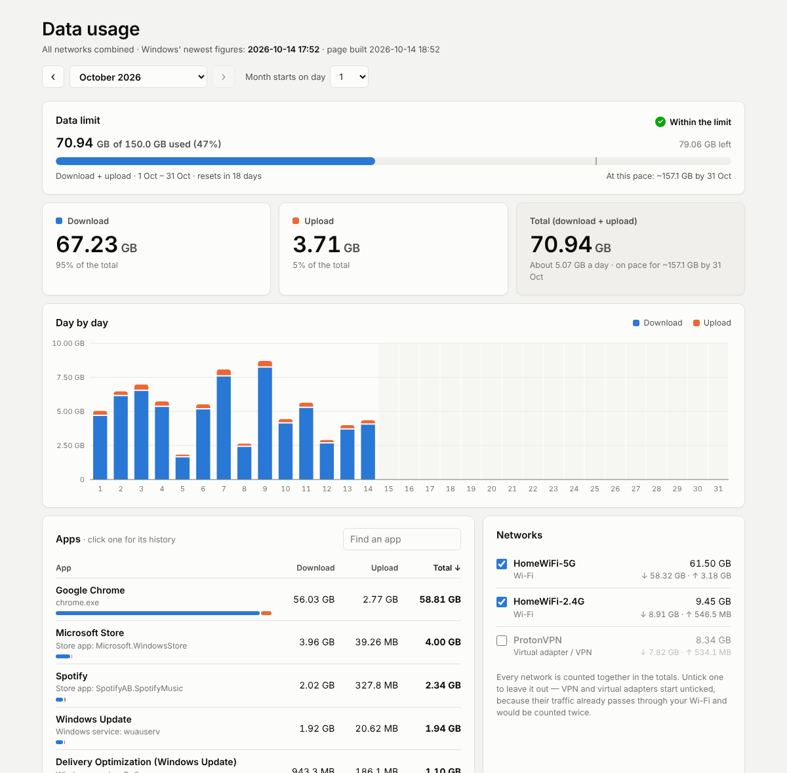

# NetUsage

**Your real monthly download and upload on Windows: one total across every network, with a per-app breakdown, kept forever.**

Windows already measures how much data every app uses, but **Settings → Network & internet → Data usage** has three problems:

- It only shows a **rolling "last 30 days"**, so the number goes up and down every day and never matches a calendar month or your internet package.
- It shows **each Wi-Fi network separately**, so if you switch between the 5 GHz and 2.4 GHz networks of the same router, you never see one grand total.
- Windows **deletes the history** after about 30–60 days.

NetUsage fixes all three. It copies Windows' own usage log every hour into a permanent history on your PC and shows it as a simple dashboard.

<picture>
  <source media="(prefers-color-scheme: dark)" srcset="docs/dashboard-dark.png">
  
</picture>

<sub>Screenshot made with sample data.</sub>

## Features

- **Real months**: October, September, … each counted on its own, or **"Month starts on day N"** to match the day your internet package renews.
- **Download and upload shown separately**, plus the total.
- **All networks added together.** Untick any network to leave it out. VPN and virtual adapters start unticked, because their traffic is already counted on your Wi-Fi.
- **Per-app breakdown** for any month, like the Windows Settings page.
- **Day-by-day chart**, a **month-by-month history**, and an estimate of where the current month will end up.
- **Nothing ever rolls off.** The history keeps growing for as long as NetUsage is installed.
- Light and dark mode, works at any window size.
- No account, no cloud, no internet connection needed. Everything stays on your PC.

## Install

1. Install **Python 3.10 or newer** from [python.org](https://www.python.org/downloads/). Tick **"Add python.exe to PATH"**. The Microsoft Store version of Python can't run background tasks, so use the python.org one.
2. Download **`NetUsage-1.1.zip`** from **[Releases](../../releases/latest)** and unzip it.
   (The green **Code → Download ZIP** button works too. In that case `Install.bat` downloads three small libraries from PyPI the first time.)
3. Double-click **`Install.bat`** and click **Yes** when Windows asks for permission.

That's it. A **Data Usage** shortcut appears on your desktop. Windows usually still has the last few weeks of usage, so the first run fills those in straight away. After that NetUsage updates itself every hour in the background; reopen the shortcut or press F5 to see the newest numbers.

Once installed, NetUsage runs from `C:\ProgramData\NetUsage`, so you can delete the downloaded folder. Keep the zip if you want `Uninstall.bat` handy.

## Uninstall

Double-click **`Uninstall.bat`**. It removes the hourly task and the desktop shortcut, and asks whether to delete your recorded history too.

Without the download folder, run this from an administrator Command Prompt:

```
py C:\ProgramData\NetUsage\app\netusage.py uninstall
```

Add `--purge` to delete the history as well.

## How it works

Windows records every app's network traffic once an hour in its *System Resource Usage Monitor* database, `C:\Windows\System32\sru\SRUDB.dat`. This is the same data the Settings page reads.

Every hour, a scheduled task (**NetUsage Collector**, running as SYSTEM) takes a shadow copy of that file, reads the network-usage table, and adds any new rows to `history.sqlite`. Rows are never deleted. Then it rebuilds `dashboard.html`, a single self-contained page that the desktop shortcut opens.

For each hour and network, Windows writes one row per app plus one row with the network's total. NetUsage uses the total row for the totals and the app rows for the per-app list, so nothing is counted twice. Any small difference shows up as "Other (not tied to an app)". Numbers use 1 GB = 1024³ bytes, the same as Windows Settings, so they should match it.

| File | What it is |
|---|---|
| `C:\ProgramData\NetUsage\history.sqlite` | Your permanent history |
| `C:\ProgramData\NetUsage\dashboard.html` | The page the desktop shortcut opens |
| `C:\ProgramData\NetUsage\collector.log` | What the hourly task did, and any errors |
| `C:\ProgramData\NetUsage\app\` | The installed program |

## Commands

From an administrator Command Prompt in `C:\ProgramData\NetUsage\app`:

| Command | What it does |
|---|---|
| `py netusage.py status` | Monthly totals in the console |
| `py netusage.py collect` | Update right now instead of waiting for the hour |
| `py netusage.py report --open` | Rebuild the dashboard and open it |
| `py netusage.py uninstall [--purge]` | Remove NetUsage |

## Limits

- **History starts when you install.** Windows keeps only about 30–60 days, so older months are already gone and can't be recovered.
- **Windows writes the usage log about once an hour**, so the most recent hour may not show yet.
- It measures **this PC only**, not other devices on your network.
- It needs the Windows usage service (the *Diagnostic Policy Service*) to be running. It is on by default.

## Reporting problems

Open an [issue](../../issues) and attach `C:\ProgramData\NetUsage\collector.log`. Please don't attach `history.sqlite` publicly: it lists the apps you use and the names of your Wi-Fi networks.

## License

NetUsage is free software: you can redistribute it and/or modify it under the terms of the **[GNU Affero General Public License v3.0 or later](LICENSE)** (`AGPL-3.0-or-later`).

In short: you may use, study, share and change NetUsage. If you share a changed version, or let people use a changed version over a network, you must make its full source code available to them under the same license.

Copyright © 2026 Sakura ([@sakurarose1](https://github.com/sakurarose1)).

It uses the `dissect.esedb`, `dissect.util` and `dissect.cstruct` libraries by Fox-IT (Apache-2.0), which the release zip includes in `lib/`. See [THIRD_PARTY_NOTICES.md](THIRD_PARTY_NOTICES.md).
